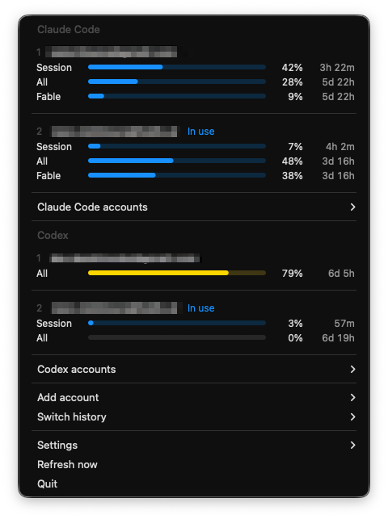
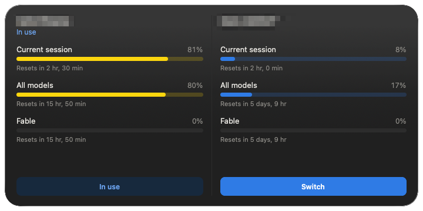

# ccswap

A multi-account switcher for Claude Code and Codex CLI on macOS. It is a Rust rewrite of [claude-swap](https://github.com/realiti4/claude-swap) v0.26.0, and adds Codex accounts, a menu bar app and a desktop widget that show every account's usage and switch between them.

## Menu bar



The menu has a section for Claude Code and a section for Codex; a section is hidden when it has no accounts. For each account, the menu shows how much of the 5-hour session, the all-models weekly limit and, for Claude Code, the per-model weekly limits (such as Fable) is used, and when each one resets. The active account in each section is marked `In use`, and clicking another account switches to it.

Each section ends with a submenu of its actions. `Claude Code accounts` can rotate to the next account (`Rotate to next`), jump to the account with the most quota left (`Switch to best`), rotate while skipping accounts at their limit (`Next available`), and add, disable and remove accounts. `Codex accounts` can rotate to the next account, log in to a new account and add or remove accounts. `Add account` collects the add actions of both, and `Switch history` lists past switches.

```sh
ccswap menubar --install-service   # start at login and restart on crash via launchd
ccswap menubar --service-status
```

## Desktop widget



The widget lays out accounts' usage side by side, Claude Code accounts first and Codex accounts labeled `Codex`, with the active account of each leading. It shows up to four Claude Code accounts, or five columns in all once Codex accounts are managed, keeping at least two for Codex. Pressing `Switch` on an inactive account makes the running menu bar switch to it. The widget ships inside `ccswap.app`; register it to make it appear in the widget gallery:

```sh
ccswap widget --install
```

## Install

Download `ccswap-<version>-macos-universal.tar.gz` from [Releases](https://github.com/ashigirl96/ccswap/releases), put `ccswap.app` in `~/Applications`, and symlink the binary inside the app onto your PATH:

```sh
tar -xzf ccswap-<version>-macos-universal.tar.gz
cp -R ccswap-<version>-macos-universal/ccswap.app ~/Applications/
ln -sfn ~/Applications/ccswap.app/Contents/MacOS/ccswap ~/.local/bin/ccswap
ccswap widget --install
ccswap menubar --install-service
```

To build from source, `just install` builds a universal `ccswap.app` and runs the steps above. `cargo install --git https://github.com/ashigirl96/ccswap ccswap` also works, but that binary comes without the widget; the CLI and the menu bar still work.

## CLI

Claude Code accounts are managed with `ccswap claude <command>`. Every `claude` command also works without the prefix (`ccswap list`, `ccswap switch 2`).

```sh
ccswap claude add                   # register the account you are logged in as
ccswap claude list                  # list managed accounts and their usage
ccswap claude switch                # rotate to the next account
ccswap claude switch 2              # switch to an account by number, alias or email
ccswap claude switch --strategy best  # switch to the account with the most quota left
ccswap claude run 2 -- --resume     # run claude as another account, this terminal only
ccswap claude map 2 ~/work          # map a directory to an account
ccswap claude auto                  # auto-switch when nearing rate limits
ccswap config set autoswitch.threshold 80
ccswap                              # interactive TUI dashboard
```

`ccswap help` lists every command, and `ccswap <command> --help` shows its options. `claude list`, `claude status`, `claude switch`, `codex list` and `codex switch` emit machine-readable JSON with `--json`.

## Codex

ccswap also manages Codex CLI (ChatGPT) accounts. They are numbered on their own, apart from Claude accounts, and show up in the menu bar and the widget beside the Claude ones.

```sh
ccswap codex add                    # register the current Codex login ($CODEX_HOME or ~/.codex)
ccswap codex login                  # log in to another account with `codex login` and add it
ccswap codex list                   # list Codex accounts with their 5-hour and weekly usage
ccswap codex switch                 # rotate to the next Codex account
ccswap codex switch 2               # switch by number, alias or email
ccswap codex alias 2 work           # name an account
ccswap codex remove 2               # forget an account; the live login stays
```

Each account's `auth.json` is kept as Codex wrote it in `~/.claude-swap-backup/codex/homes/<number>/`, with the list of accounts in `~/.claude-swap-backup/codex/accounts.json`. A switch saves the live `auth.json` back to its owner, then replaces it with the chosen account's.

- A switch takes effect in codex sessions started afterwards. A codex that is already running keeps the old account in memory, and stops with a "signed in as a different account" error on its next token refresh or 401. Restart it.
- If the Codex app-server daemon is running (`~/.codex/app-server-daemon/` exists), restart it with `codex app-server daemon restart`. ccswap prints this reminder but does not restart the daemon itself.
- Only Codex's default file storage is supported. If `cli_auth_credentials_store` in `~/.codex/config.toml` is `keyring` or `auto`, `ccswap codex switch` refuses and changes nothing.

## OpenAI mode for Claude Code

OpenAI mode sends Claude Code inference to OpenAI using your ChatGPT plan. First register the ChatGPT account with `ccswap codex add` or `ccswap codex login`, then create a separate inference login for its Codex account number:

```sh
ccswap claude openai login 1        # Continue with ChatGPT in your browser
ccswap claude openai status         # inference destination and each account's login
ccswap claude openai on             # requires the menu bar to be running
claude                             # direct launches also use OpenAI
ccswap claude openai off            # restore Anthropic for new sessions
ccswap claude openai logout 1       # remove that account's saved inference tokens
```

The menu bar's `OpenAI mode` checkbox also switches the mode. ccswap changes only its inference keys in `~/.claude/settings.json`; conflicting user values are reported and preserved. Changes apply reliably to new sessions. Quitting the menu bar or uninstalling its LaunchAgent turns the mode off; crash restarts keep it enabled.

Inference uses the active Codex account's inference login, including after `ccswap codex switch`. Opus, Sonnet and Fable use `gpt-6.1-sol`; Haiku uses `gpt-6-luna`. Shared `ccswap run N` profiles inherit the mode, while `--no-share` profiles remain independent. Remote Control and voice input are unavailable while OpenAI mode is enabled. Sign in with ChatGPT is in preview, and Claude Code does not officially support models other than Claude through gateways.

## Relationship to claude-swap

ccswap follows claude-swap v0.26.0's behavior and reads and writes the same store in `~/.claude-swap-backup/`. Intentional differences are recorded in [docs/adr/0001-deviations-from-upstream.md](docs/adr/0001-deviations-from-upstream.md).

## License

MIT
